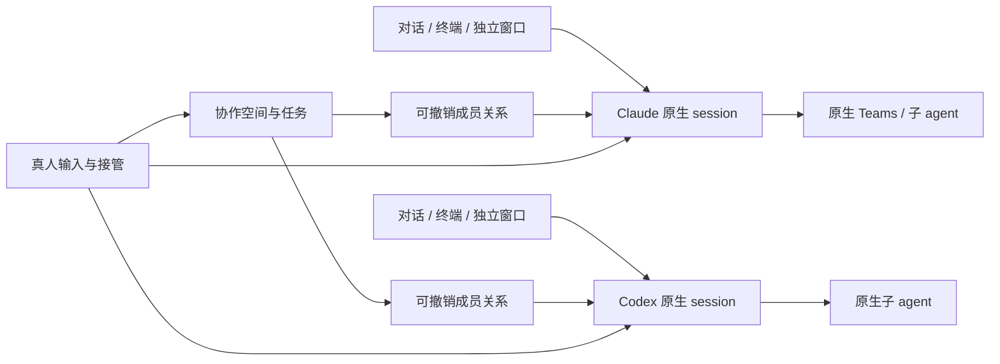

# 架构与边界

As of 2026-10-17。领域关系是设计决定；Codex 空闲连接已有[限定实测](native-continuity.md)，完整 provider 连续性仍待验证。

## 核心对象

| 对象 | 拥有什么 | 不拥有什么 |
| --- | --- | --- |
| AgentSession | 本应用稳定 ID、provider 原生 ID/句柄、配置引用、运行状态 | 房间生命周期、另一 agent 的私有历史 |
| Native runtime | 原生上下文、工具执行、权限、Teams/subagent fleet、原生存储 | 本应用所有房间的统一治理 |
| Room | 任务目标、成员关系、共享资料引用、协作事件与运行策略 | 参与者进程、完整私人对话 |
| Membership | session-room 关系、共享授权、起止序号与修订号 | native session 的复制品 |
| View | 窗口、标签、对话、终端、焦点和布局 | 第二个 agent 运行实例 |
| CollaborationRun | 一项任务的交接队列、边界、完成/等待状态 | 永久模型主持人或新的原生 fleet |
| Artifact | 带版本的成果引用和读取授权 | 对整个本机文件系统的隐式授权 |



删除视图不销毁 session；退出房间不销毁 session；归档房间不杀掉成员 fleet。关闭程序、停止 agent、归档和删除历史需分别定义。首版不承诺操作系统重启后仍保有活跃进程；原生恢复能恢复什么就如实显示什么。

## 逻辑分层

1. **桌面视图**：熟悉的对话、原生终端、成果和按需协作；渲染层不能直接读取凭据或任意执行命令。
2. **本机 session 服务**：唯一运行时所有者，提供输入串行化、视图订阅、持久状态和进程生命周期；主窗口重建不应重启 agent。
3. **协作控制**：普通程序维护成员、授权与交接，不调用额外模型当路由器。
4. **provider adapter**：使用上游支持的 CLI、PTY 或结构化接口；保留各自能力及原始事件。
5. **平台接口**：PTY/进程、凭据引用、文件授权、窗口、睡眠与通知；macOS 先实现，Windows/Linux 后补。

这是职责分离，不要求第一版部署成五个服务或维护五套数据库。建议本机一个进程服务与桌面渲染层，以 Electron/TypeScript + React 作为 DSH 试验的优先组合；在技术验证前不安装依赖或锁定全部框架。

### 已实现的升级边界（alpha.8）

DSH 界面和 Electron 窗口继续独立于原生进程。`service-layout.cjs` 保存私有后台路由，
`service-client.cjs` 启动/连接对应版本，`workspace-client.cjs` 在主进程合并显示并按
会话归属转发。新会话使用当前后台；存量会话仍由原服务单独写入和管理。
不在升级时复制 transcript、恢复活会话或重放任务；它不是原生进程迁移协议。

共享视图组合各后台已经明确共享的记录，不把私人历史交给别的 agent。
跨后台只提供真人定向分享，自动 run 仍属于单个后台，不能跨版本开启。
能力按每个会话所属后台判断，不能用全局新版本放开旧实现的权限/发送限制。
该路径的正常升级与已知限制见 [alpha 验证](alpha.md#updates-with-live-sessions)，
并发、故障和资源问题以 [审查记录](review.md) 的复验状态为准。

## 身份与输入

本应用 session ID 映射到一个确定的 provider 原生 session。恢复映射需要校验 provider、原生 ID 与运行状态；不以 PID 单独认定身份，不把“相同历史”当作“同一运行实例”。

一个原生 session 的程序输入经过单一写入队列。多个视图可以观察，只有一个当前控制通道提交原子输入。GUI、终端字节、房间任务不能交错拼成一条命令。所有输入带来源、目标、任务修订号和发送状态；未知发送结果不盲目重试。

普通主 agent 没有永久主从关系。每个 CollaborationRun 可指定作者/检查者等临时任务职责；这不改变其原生 fleet 的父子关系，也不把 Codex 放进 Claude SDK 的 subagent 槽位。

## 加入与退出的事务边界

加入只写入 Membership 与用户选择的共享授权。默认不构造新提示词、不转发全历史、不重启模型、不变更原生 owner。

退出先增加成员修订号并撤销房间路由，再取消未发送交接。每次实际派发前重新校验成员、授权、任务修订号和控制状态。已提交输入保持“已提交”或“待确认”，不能在日志中改成未发送。离开与加入新房间的路由切换必须原子化，避免两个房间同时派发。

建议首版每 session 最多一个自动路由房间；这只是首版约束。架构用 Membership 对象表达关系，为未来多房间访问保留扩展空间。

## 协作与人类优先

```text
draft → running → waiting_for_agent / waiting_for_human → completed
                 ↘ paused / stopped / failed
```

一次核查默认到结果就停。持续协作有有限交接次数、墙钟期限与重复失败边界；不因成功写入 PTY 就计作完成。完成由任务定义的成果/验证条件决定；必要时由用户指定完成判断，不额外调用“裁判模型”。

接管先冻结路由并增加任务修订号，撤销未提交旧消息，再请求原生中断。收到确认才显示对应范围已停止；顶层中断不自动证明后代已停止。缺少原生接口时，关闭相关无人值守能力，不以 UI 假状态掩盖。

原生 fleets 自己的自治、内部消息与工具消耗仍由 provider 管理；上层交接次数不是其总 token 或费用上限。适配器必须分别报告可见范围、可控范围与计量范围。

## 原生能力与 GUI/TUI

每个 adapter 报告实际版本与能力：实时 attach、持久恢复、结构化事件、终端输入、原生提问/审批、fleet 观察/中断、用量覆盖、可执行的文件/网络边界等。能力可以是支持、部分支持、不支持或未知，并带证据版本。

Claude 优先验证未修改的交互式原生 CLI 路径，以保留完整 Teams。Codex 优先验证持久 app-server 主 session 与原生 TUI 的同身份路径；若不能成立，应保留同一 PTY 路径继续试验，不把 GUI 与另一个 TUI 进程拼成“无缝切换”。

结构化 UI 是原生会话的增强视图，不能为了统一而删掉未知事件。未知交互显示可用的原生入口，无法安全表达的动作不自动批准。上游能力变化要通过兼容验证后放行；不宣称天然支持未来全部 fleet。

## 隐私与权限

成员关系只控制本应用的分享，不自动形成 OS 沙箱。凭据留在 provider 原生目录与认证流程；应用不提取 OAuth token 并转交 SDK。会话历史不随入房自动广播。

共享对象包括选定消息、成果版本和必要文件；日志记录来源、接收方和授权，不暗中复制完整私有历史。不能把发来的自然语言当作真人批准，另一 agent 的输出也不能扩大权限。

保留上下文意味着 agent 的生成结果可能包含原先见过的信息。提示词要求保密不是严格的防泄露边界。默认跨 provider 交接使用明确选定的任务材料；无人值守只在用户已信任该 session 的任务范围内开放。需要严格隔离时使用新的会话并明确解释上下文取舍，不假装能清洗现有会话记忆。

退出仅阻止后续本应用路由；已发内容无法撤回，原生磁盘/网络权限也必须由真实执行端回收。危险工具继续使用原生审批；房间批准不能绕过更严格的 native 策略。

本机存储用应用数据目录、最小文件权限与原生凭据引用；保留/导出/删除语义需覆盖房间记录和缓存，原生历史由 provider 管理。默认无本产品遥测、自动日志上传或远程分享。模型服务仍会接收用户选择提交的内容；本地界面不等于离线推理。上游遥测设置应可见且尊重其官方关闭机制。

## 持久化、恢复和文件冲突

候选使用一个本机事务存储保存身份映射、成员关系、交接状态与审计事件；不另外成为原生 transcript 的权威存储。重建 UI 可从事件恢复，但不得重发不确定是否已接收的模型输入。

断线、窗口崩溃、系统睡眠和 runtime 退出分别处理。恢复时重新确认活跃 owner 与任务修订号；授权不足或协议漂移时等待，不自动改用另一个 provider。

共同工作不等于无锁同时写同一个文件。首条流程采用作者写入、检查者返回修改建议，成果用版本/哈希定位。代码项目未来可用 worktree；普通文档也需冲突检测，不能静默覆盖。磁盘写入失败要保住原始成果。

## 成本和延迟

壳层路由、标题、摘要、状态轮询默认零模型调用；仅发任务所需内容。必要的协作消息和工具 schema 也计入输入开销，不能以“不是 API 调用”排除。

对比同版本、模型、权限、材料、任务和缓存条件下的原生执行：记录模型调用、输入/输出/cache token、完成质量、时间及额外用户操作。随机输出导致总量不同，应重复有代表性的对照，不承诺精确相等。延迟报告壳层增量与原生模型时间，阈值待测量后确定。

若隐藏总结/主持人调用、重复上下文或壳层额外推理是必要条件，当前方案未满足要求，应调整架构。用量缺失不显示为零，不能把顶层预算包装成 fleet 全局硬帽。
