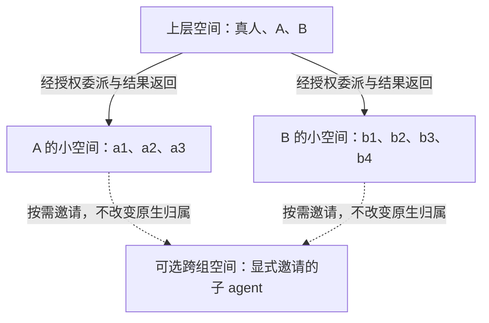

# 多层协作空间：研究与设计边界

As of 2026-10-21。这是未来设计与源码研究，**不是已经提供的多房间／子 agent 直连功能**。现阶段继续保留 DeepSeek Harness 与各原生运行时。

状态：按用户最新决定，作为以后可能继续研究的设计讨论保留，退出当前实现队列。下文的 P1/P2 是重新启动该研究后的进入条件，不是当前待执行里程碑。实际使用出现跨组沟通阻塞、且原生寻址能力可验证时，再重新评估；当前验收先覆盖已有单会话与协作的完整使用流程。

问题：人希望 A、B 和各自的子 agent 可以分组或跨组交流，只有当前空间内被选中的成员接收任务，上层仍能了解下层情况。
现有机制：`app/workspace.cjs`、`app/renderer/renderer.js`、`app/renderer/fleet-observation.js` 已有独立原生会话、一个共享空间、明确接收者、有限交接与只读子任务观察；没有任意原生子 agent 的可靠寻址接口。
最小增量：先确定通信与上下文边界、记录上游证据及进入实现的条件；不引入新的编排运行时。
不做会坏什么：把“属于哪个父 agent”“能在哪个空间出现”“实际收到哪些内容”混成一件事，会造成意外广播、重复上下文与错误的隔离承诺。

本次服务于产品架构和开发优先级决策。范围为三个框架实现、三篇相关论文及工程经验；不运行论文基准、不增加原生模型测试。主要读数是一次人类动作实际触发的接收者与调用数、越界投递数、重复投递数和上下文带入量。以下推荐是针对本产品约束的判断，不是论文证明了某种拓扑普遍最好。

## 找到了什么

| 一手材料 | 实际机制与可借鉴部分 | 本产品不能直接照搬的部分 |
| --- | --- | --- |
| [AgentScope MsgHub v1.0.21 源码](https://github.com/agentscope-ai/agentscope/blob/v1.0.21/src/agentscope/pipeline/_msghub.py) | 显式参与者列表、加入/移除、命名订阅及广播。与“空间里有哪些 agent”很接近。 | `enable_auto_broadcast` 默认开启；`observe` 写入成员上下文不等于立刻推理，但会影响后续输入。我们应明确区分加入、看见、接收和执行。这是固定的 1.x 源码参照，不能当成当前 2.x API 承诺。 |
| [AutoGen SocietyOfMindAgent 源码](https://github.com/microsoft/autogen/blob/004749e6b7102c8fd317b9b1499ce5807223c278/python/packages/autogen-agentchat/src/autogen_agentchat/agents/_society_of_mind_agent.py) | 把内部团队包装成上层的一个 agent；内部事件可以流式显示，对外返回一个响应。适合理解“上层只问负责人、仍能查下层过程”。 | 非空内部结果后会调用模型生成外层响应，并重置内部团队；不是保留任意原生长期会话的透明外壳。历史 [#6123](https://github.com/microsoft/autogen/issues/6123) 讨论过内部消息影响外层终止判定，已由 #6142 关闭，不能说当前仍未修。 |
| [LangGraph Supervisor](https://github.com/langchain-ai/langgraph-supervisor-py)；[handoff 源码](https://github.com/langchain-ai/langgraph-supervisor-py/blob/88859b34017ac3569bbd4a3092c7e77593a0a960/langgraph_supervisor/handoff.py)；[supervisor 源码](https://github.com/langchain-ai/langgraph-supervisor-py/blob/88859b34017ac3569bbd4a3092c7e77593a0a960/langgraph_supervisor/supervisor.py) | 支持层级 supervisor；返回历史可选 `last_message` 或 `full_history`。显式交接比自由互聊更容易追踪。 | 默认交接传递当前 messages 状态；输出只留最后一条不等于输入历史也被隔离。截至本次核查仓库已归档，不作为新基础依赖。 |
| [AgentPrune，2024](https://arxiv.org/html/2410.02506v1) | 把通信表示为空间与时间的边，学习剪掉无效消息传递；作者在其基准中报告 token 降幅 28.1%–72.8%。支持“通信越多未必越好”的研究方向。 | 训练与任务基准不等于真实桌面产品效果；不能把其节省比例作为我们的承诺，也不值得现在训练路由器。 |
| [AgentCoord，2024](https://arxiv.org/html/2404.11943v1) | 结构化呈现任务、成员、依赖和结果对应关系，并进行 12 人用户研究。适合借鉴“谁在做什么、这条结果属于哪项任务”的可读性。 | 论文原型需要模型辅助生成策略，且明确仅支持静态策略设计与文本环境；不证明运行中自由搬动原生会话已解决。 |
| [ACTS，2026-10-19 预印本](https://arxiv.org/html/2610.25851v1) | 按角色和运行状态选择通信对象；中央训练、分散执行。论文实验为三个角色 agent 加最终汇总节点，调度器训练 50 episodes。 | 刚发布且未在这里复现；不是任意规模、跨厂商原生子 agent 的成品协议。我们借鉴按需通信，不加入训练系统。 |

[Anthropic 的多 agent 研究系统经验](https://www.anthropic.com/research/multi-agent-research-system)也强调明确委派边界与返回结果，指出并行探索适合部分研究任务、强共享上下文和紧密依赖的任务未必适合。其成本数据来自该系统，不能外推成所有 agent 的固定倍数。

## 对本产品的建议

保留三套独立关系，不让界面层级替代权限：

1. **原生归属**：A 拥有 a1/a2/a3，B 拥有 b1/b2/b3/b4。生命周期、原生任务表和父子消息继续由 provider 管理。
2. **空间成员**：上层空间有真人、A、B；下层可以是两个小空间，也可以是一个七成员空间。成员关系可以变化，原生身份不随之变化。
3. **消息与授权**：每条任务明确记录发送者、空间、接收者、来源材料、授权范围和状态。一个成员存在于列表里，不意味着每条消息都会进入它的模型上下文。

图表示可选协作关系，不是自动全员投递。邀请跨组空间的成员必须具备经过验证的原生消息能力；仅观察到一个子任务名称，不能据此创造一个可控制的独立会话。

**默认采用分组协作，允许明确选出的跨组交流。** A/B 可以平等参与，上层不增加永久的“总指挥模型”。任务适合独立分解时，用 A/B 原生委派与结果返回；确实需要子 agent 互相核查某份产物时，再让相关成员进入一个小空间。七个成员能共处一室，不代表任何一条消息必须唤醒七个成员。

人进入或浏览一个空间只改变视图。输入框的 `@` 只列本空间可寻址成员；直接发给空间外成员要先明确进入对应空间或邀请，不能偷偷扩大接收者。原生父 agent 在已授权任务内委派给自己的后代，是原生行为，不能用空间列表伪装成对整个 fleet 的强制限制。

## 上层如何了解下层，如何保留 memory

- 状态、任务关系、阻塞和来源链接由程序展示，不为刷新界面调用模型。上层可以展开下层轨迹；这是人的观察权限，不是给上层 agent 自动投喂完整日志。
- 已有原生父子结果返回优先原样利用。真人问 A“你的小组怎么样”时，由 A 在这次明确请求中回答；缺少证据就说明未知，不另起模型持续生成汇总。
- 空间保存共享记录、明确接受的结论/笔记、材料引用与成员变更。原生会话保留自己的上下文；两者不靠反复复制全部历史维持同步。
- 新成员默认不自动收到旧私人对话。必要背景由人预览后选取，或在已授权任务规则内传递；发过的材料记录内容版本和因果来源，重试不能重复提交。
- 离开立即阻断该空间后续的新路由，已接收任务与旧记忆仍存在。重新加入按需要带入选定的新背景，不能将“离开”包装为遗忘或撤回。
- **父 agent 原本就可能读取子任务结果，共享磁盘也可能可读。** 房间隔离只管 Portal 的投递；要求真正彼此保密，需要原生权限/沙箱支持。无法执行的隔离不能画一个锁图标就宣称实现。

## 无隐性开销与可控执行

默认不增加 LLM 路由、心跳、标题或自动摘要调用。显式有限交接沿用本地状态机；被选中的 agent 才接收任务，人数、回复数、截止时间和重复消息去重都能核对。人在上层改变方向时，旧授权队列停止继续派发；已由原生接收的任务要分别呈现运行/停止状态，不能把“停止转发”说成“全部后代已停”。

上下文按需共享，不代表数学上保证同等任务 token 完全相等。需要把 Portal 发起的调用、原生额外工作和未知用量分别说明。只有 provider 提供可信成本/取消能力时，才能实现相应硬上限；现有有限回复数不等于金额硬上限。

## 实现优先级与验收门

当前只落实这个设计边界，继续完成已有日用流程。不是先新增多级导航、画布或自动分组工具。

| 优先级 | 进入条件与完成读数 |
| --- | --- |
| P0：既有单会话与多人协作可靠 | 输入、原生过程、阅读、加入/脱出、保存恢复的实际 UI 回归；未经授权投递为 0；界面切换不新增原生任务。 |
| P1：原生子任务能力核实 | 区分可观察、可寻址、可输入、可停止、可恢复；分别验证 Claude/Codex，不把一方成功推广到另一方。缺能力时只展示真实状态。 |
| P2：最小多空间试点 | 有可靠寻址后，先两空间、一个明确跨空间交接；试点要求一个 session 同时最多接受一个空间自动调度。覆盖移出前排队、迟到回复、同名成员、重开和暂停。 |
| 以后做：动态分组或自动拓扑 | 真实任务显示手工选择成为主要阻塞、且基础路由/计量可核后再评估。无对应需求，不建训练路由器。 |

后续测试先用零模型的 A/B + 3/4 子任务 transport 验证接收集合：Portal 不自动向未选子成员直接投递上层消息（原生父会话的委派行为另计）；跨组消息只到明确选中的成员；移动成员不重启原生；迟到消息不能越过旧授权；观察下层不会生成模型调用。真实 provider 只测无法由这些检查证明的寻址/权限能力，每次有限任务预算。

## 来源、版权与未知

本次未复制第三方实现、图片或增加运行依赖。源码核查范围是表内指定文件及其消息流，不能当成完整项目审计。AutoGen 代码使用 [MIT](https://github.com/microsoft/autogen/blob/004749e6b7102c8fd317b9b1499ce5807223c278/LICENSE-CODE)，其文档许可另列；AgentScope 该版本的 [LICENSE](https://github.com/agentscope-ai/agentscope/blob/v1.0.21/LICENSE) 为 Apache-2.0；LangGraph Supervisor 的 [LICENSE](https://github.com/langchain-ai/langgraph-supervisor-py/blob/88859b34017ac3569bbd4a3092c7e77593a0a960/LICENSE) 为 MIT。未来实际复用仍需核具体文件、版本和署名。没有把 AgentPrune/ACTS 论文公开等同于其代码可任意复制。

会变化的项：上游 API、仓库归档状态、模型计量与权限、论文版本。未完成的证据：上述论文独立复现、任意 Claude/Codex 子 agent 互通、跨空间安全沙箱、全部 fleet 的成本与取消硬保证。当前产品没有这些完整能力；这份设计避免现在的架构把以后实现它们堵死。
